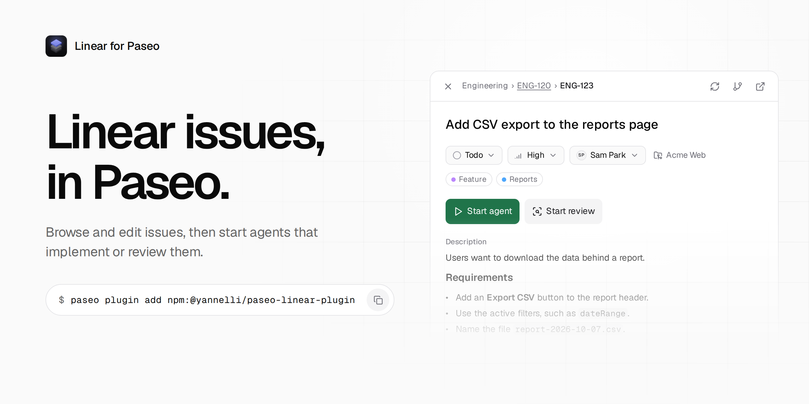
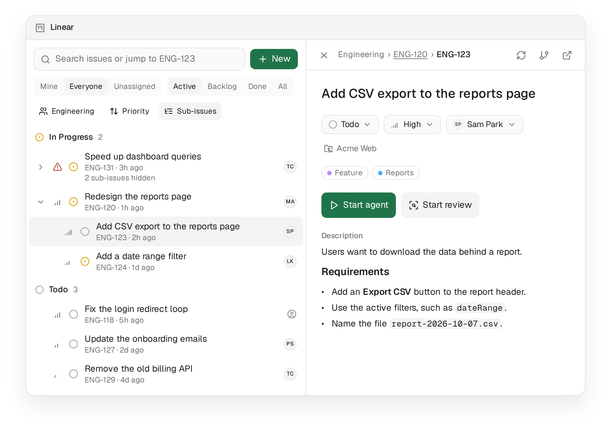
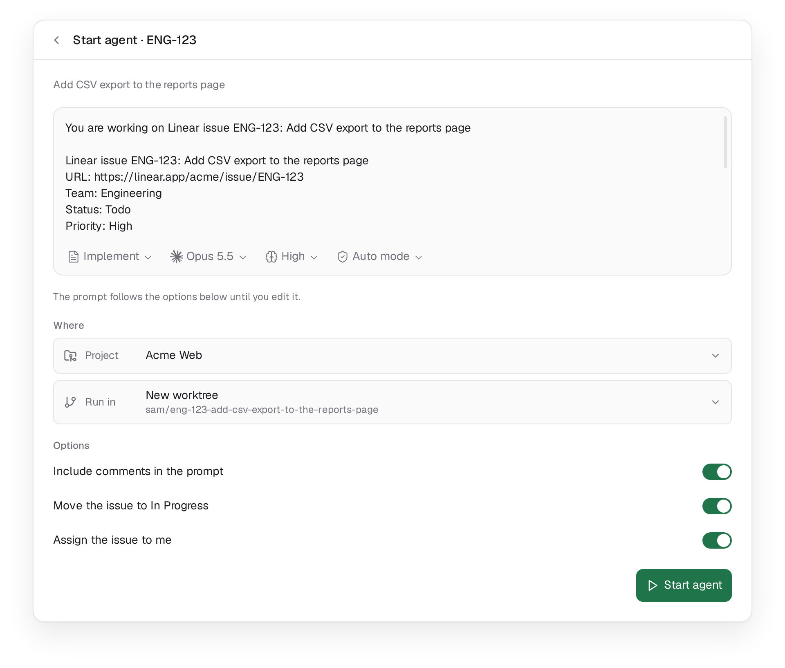

<picture>
  <source media="(prefers-color-scheme: dark)" srcset="docs/images/hero-dark.png">
  
</picture>

# Linear for Paseo

A [Paseo](https://paseo.sh) plugin for [Linear](https://linear.app). Browse and edit issues in a Linear screen or a workspace panel, then start agents that implement or review them. Your Linear API key stays on the daemon host.

- **Issues**
  - Search, filter, and sort, with sub-issues nested under their parent
  - Breadcrumbs show an issue's parent chain
  - Change the status, priority, and assignee, add comments, and create issues
  - Descriptions and comments render as Markdown
  - The description saves as you type. Task list boxes check off without opening the editor.
  - Saved results show at once while the plugin gets new data from Linear
- **Agents**
  - **Start agent** and **Start review** on any issue. Pick the prompt, agent, model, effort, project, and where it runs.
  - Each sub-issue can get its own agent, model, and thinking level, and the agent you start hands it off
  - Agent todos move sub-issues to In Progress and Done. Off until you turn it on.
  - The plugin's Linear tools for agents, on or off
- **Projects**
  - Linear on or off for all projects, or project by project
  - A different Linear key and agent defaults per Paseo project
  - A setup agent that reads a project's guidelines and proposes its instructions and steps
- **Composer**
  - A **Linear** pill on each agent that opens its issue, or sends an issue to any agent
  - **Attach Linear issue** in the attachment menu
  - `/linear ENG-123` opens an issue, and `/linear <text>` searches

<picture>
  <source media="(prefers-color-scheme: dark)" srcset="docs/images/browse-dark.png">
  
</picture>

<picture>
  <source media="(prefers-color-scheme: dark)" srcset="docs/images/launch-dark.png">
  
</picture>

<sub>Illustrations with sample data, rendered from <code>docs/graphics</code>.</sub>

## Install

You need Paseo 0.11.0 or newer and a Linear personal API key.

**Step 1 - Turn On Plugins**

In Paseo, turn on **Enable plugins** in **Settings → Plugins**.

**Step 2 - Add the Plugin**

```sh
paseo plugin add npm:@yannelli/paseo-linear-plugin
paseo plugin ls paseo-linear-plugin
```

**Step 3 - Connect Linear**

Create a key in Linear under **Settings → Security & access → Personal API keys**. To change issues, add comments, or create issues, the key needs write access. Paste it in **Settings → Plugins → Linear → Account** and select **Connect Linear**.

To use `LINEAR_API_KEY` from the daemon's environment or a key per project instead, see [Connect Linear](docs/connect.md).

Then open **Linear** from the sidebar, or type `/linear` in the composer.

### Other versions

- Pin a version: `npm:@yannelli/paseo-linear-plugin@1.2.1`
- Install a Git tag: `paseo plugin add github:yannelli/paseo-linear-plugin --ref v1.2.1`
- Upgrade from 0.4.0 or earlier: those used the id `linear`. Run `paseo plugin remove linear` first, then add the plugin again. Your saved keys stay in place.

Plugins run trusted code with the daemon user's access.

## Docs

| Guide | What's in it |
| --- | --- |
| [Connect Linear](docs/connect.md) | The default key, `LINEAR_API_KEY`, project keys, and which key wins |
| [Issues](docs/issues.md) | Browsing, sorting, sub-issues, editing, attachments, the Linear pill, and Linear per project |
| [Agents](docs/agents.md) | The agent setup page, agent guidance, sub-issue agents, agent settings, todo sync, and project setup |
| [Plugin icon](docs/icon.md) | The plugin mark, your own SVG, and how they're painted |
| [Data and permissions](docs/data-and-permissions.md) | What goes to Linear and your agent provider, and what the daemon stores |
| [How it works](docs/architecture.md) | What each source file does, in the app and on the daemon |

## Development

Use Node.js 24.

```sh
git clone https://github.com/yannelli/paseo-linear-plugin.git
cd paseo-linear-plugin
npm ci
npm run check
paseo plugin add "$PWD"
```

`npm run check` runs the typecheck and the tests. The tests use a local GraphQL server and don't call Linear. After you edit the source, run `paseo plugin reload paseo-linear-plugin`.

[CONTRIBUTING.md](CONTRIBUTING.md) covers the checks, commit messages, the graphics, and releases. Report security problems privately, as described in [SECURITY.md](SECURITY.md).

## License

Apache License 2.0. The plugin started as the Linear example plugin (`plugin-examples/linear`) in [getpaseo/paseo](https://github.com/getpaseo/paseo). See [NOTICE](NOTICE).

Maintained by [Ryan Yannelli](https://ryanyannelli.com).
