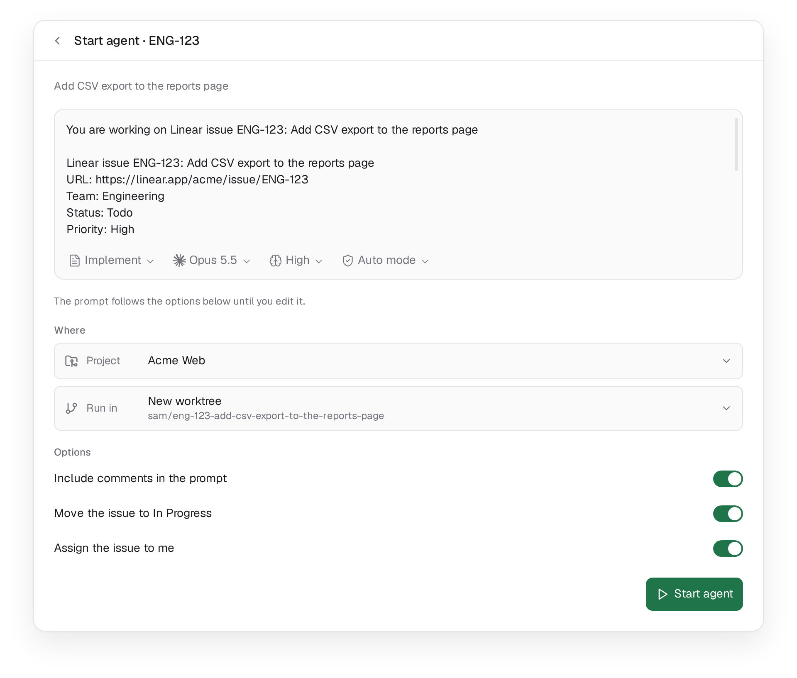

# Agents

Start agents from issues, choose the Linear tools they get, and let their todos move sub-issues. A setup agent can also propose a project's instructions.

- [Start an agent](#start-an-agent)
- [Agent guidance](#agent-guidance)
- [Agent settings](#agent-settings)
- [Update Linear from agent todos](#update-linear-from-agent-todos)
- [Set up project prompts with an agent](#set-up-project-prompts-with-an-agent)

## Start an agent

<picture>
  <source media="(prefers-color-scheme: dark)" srcset="images/launch-dark.png">
  
</picture>

Select **Start agent** or **Start review** in the issue view. The agent setup page opens in the panel or the screen. It works with or without a current workspace.

1. Edit the prompt in the prompt box if you want. The prompt follows the template and options until you edit it. Select **Reset prompt** to go back to the template.
2. Use the controls under the prompt box, as in the Paseo composer. They set the prompt template (Implement or Review), the model, the thinking level, and the mode. The thinking level shows when the model has levels, and the mode shows when the agent has modes.
   - The model picker lists the providers first. Select a provider to see its models, or search to find models from all providers.
   - Choosing a model from another provider also changes the agent. The thinking level and mode change to the choices you last used with that agent, or to its defaults.
   - The controls start from your last choices: the model, thinking level, and mode of your last launch from the plugin, then the choices Paseo remembers for new agents. A default model in the settings takes priority for the model.
   - On the mobile app, the plugin cannot read Paseo's choices, so it remembers only launches from the current session
3. Choose the **Project**. The default is the project of the current workspace. Without a workspace, it is the last project you used for the team, then a project mapped to the team.
4. Choose where the agent runs in **Run in**:
   - **New worktree** on the issue branch
   - **Check out PR #N** for a review, when the issue links a GitHub pull request
   - **Check out issue branch** for a review. If nobody pushed the branch yet, the plugin starts a new worktree on it.
   - **Existing agent workspace** or **Implementation workspace**, when an agent already works on the issue
   - **This workspace**, or **Project folder** when you are not in a workspace of that project

   The worktree and checkout options show only for a Git project. When agents run in worktrees (the default), a review uses the pull request, then the implementation workspace, then the issue branch.
5. Set the options: **Include comments in the prompt**, **Move the issue to In Progress**, and **Assign the issue to me**. The last 2 show only for Implement, and only when they would change the issue.
6. Set the **Agent guidance** switches. See [Agent guidance](#agent-guidance).
7. For Implement on an issue with sub-issues, choose agents in **Sub-issue agents**:
   - Select the chip next to a sub-issue to choose the agent and model, then the thinking chip to change the thinking level
   - Select **×** to remove the agent
   - The prompt lists the sub-issues with an agent, and the agent you start hands each of them off with `start_agent`, which runs it on the chosen agent
   - The chosen thinking level wins over the one the agent asks for
   - An agent of the same provider runs in the mode of the agent you start
   - The agent you start does the other sub-issues itself, or hands them off when **Hand off work to Paseo agents** is on
8. Select **Start agent** or **Start review**

The plugin starts the agent and then updates Linear. If the Linear update fails, the agent keeps running and a message shows the error. The agent's timeline gets a card that links to the issue. The issue view lists the agents started from it under **Agents on this issue**.

### Prompt templates and defaults

Set the default model, where agents run, the default options, and the Implement and Review templates in **Settings → Plugins → Linear → Prompts**. In **Projects**, add instructions and steps for a project, append to or replace a template for that project, or give the project its own defaults.

## Agent guidance

Each **Agent guidance** switch on the agent setup page adds instructions to the prompt. The project keeps your choices for its next launch.

- **Keep Linear updated**
  - The agent edits the issue description as it works
  - It checks off each task list item it finishes and updates the plan when it changes
  - It posts comments and creates issues only when you ask
  - Todos start with their issue key, so [todo sync](#update-linear-from-agent-todos) can move each sub-issue
- **Subagents state their issue key**
  - Each subagent's description and prompt start with the key of the issue it works on
  - The subagent states the key again when its work moves to another issue
- **Hand off work to Paseo agents**
  - The agent starts one Paseo agent for each sub-issue instead of its built-in subagents
  - Each one runs in the same workspace on the same provider and model, with thinking that fits its task, and checks off its own items

### Linear tools for the issue

**Keep Linear updated**, **Hand off work to Paseo agents**, and sub-issue agents give the agent the plugin's `linear` MCP server for the issue and its sub-issues. Its tools:

- `read_issue`
- `edit_issue`: description
- `update_issue`: status, assignee, priority, and title
- `comment_issue`
- `create_issue`: a new sub-issue of the issue
- `start_agent` and `wait_agent`: agents on the sub-issues

Agents that `start_agent` starts get all of them except `start_agent` and `wait_agent`. Paseo allows these tools without a permission prompt.

When the Linear tools are off for the project, **Hand off work to Paseo agents** is off, and **Keep Linear updated** only asks for issue keys in todos. If the tools do not start, the agent still starts, the message after the launch shows the error, and the prompt tells the agent not to look for a Linear CLI or API key. See [Agent settings](#agent-settings).

### Claude hooks

For Claude agents, these switches also add Claude Code hooks:

- With **Subagents state their issue key** on, each subagent gets the issue keys when it starts
- With any switch on, the agent gets the issue again after Claude compacts the conversation
- The hooks only print that text

See [Data and permissions](data-and-permissions.md#agent-access) for the files the daemon writes.

## Agent settings

**Settings → Plugins → Linear → Agents** applies to all projects:

- **Give agents the Linear tools**
  - Agents get the `linear` MCP server
  - Agents started from an issue get it when an option needs it
  - When you turn it off, no new agent gets the server, and agents that have it get no tools from it
  - Those agents get a message that the tools are off
- **Give every agent the Linear tools**
  - Every other agent in a project with Linear on gets the `linear` MCP server when Paseo creates it, with the project's Linear key
  - This includes agents you start from the composer and agents with an attached issue
  - Its tools are `search_issues`, `read_issue`, `edit_issue`, `update_issue`, `comment_issue`, and `create_issue`, and they reach every issue the key reaches
  - Paseo allows `search_issues` and `read_issue` without a prompt
  - The other tools follow the agent's permission mode
  - Only Claude, Codex, OpenCode, and providers whose agents report MCP support get the server
  - Agents that existed before you turned this on do not get it
- **Let agents change issues**
  - Covers the `edit_issue`, `update_issue`, `comment_issue`, and `create_issue` tools
  - When it is off, agents can only read issues
- **Choose agents for sub-issues**
  - Shows **Sub-issue agents** on the agent setup page
  - Turn it off to hide the section
- **Agents at the same time**
  - How many agents one launch can run at the same time with `start_agent`
  - When the limit is reached, `start_agent` refuses until one of them finishes
  - The prompt gives the limit
- **Update Linear from agent todos**
  - Moves sub-issues from the agent's todos. See [Update Linear from agent todos](#update-linear-from-agent-todos).

The daemon reads the tool settings for each tool call, so a change applies to agents that already run.

### Settings for one project

In **Projects**, the **Agent defaults for this project** and **Linear tools and sync for this project** sections give a project its own values: the model, where agents run, the 3 launch options, and the 6 settings above. Each one starts at **Same as all projects**, which shows the current value for all projects. The agent setup page uses the values of the project you choose.

## Update Linear from agent todos

Turn on **Update Linear from agent todos** in **Settings → Plugins → Linear → Agents**, or for one project in **Projects**. For implement agents on an issue with sub-issues, the prompt asks the agent to start each todo with its sub-issue key, such as `ENG-124: add the queue`. After each turn of an implement agent, the daemon reads the agent's todos:

- A sub-issue with a todo in progress or done moves to the team's first started status, such as In Progress
- A sub-issue whose todos are all done moves to the team's first completed status, such as Done
- The parent moves to In Progress when work starts. When every sub-issue is done, it moves to a started status whose name has "review", such as In Review. It never moves to Done by itself.
- Statuses only move forward. Canceled issues and issues outside the parent and its sub-issues never change.

The daemon reads the issue from Linear before each sync, so a status you changed by hand counts. **Sync now** in the [Linear pill](issues.md#linear-pill) runs the same check at once.

## Set up project prompts with an agent

The setup agent finds and reads the project's AGENTS.md, CLAUDE.md, CONTRIBUTING, README, scripts, and CI files, and in a monorepo the guidance files of each package. It then proposes project instructions, steps, and text to add to the Implement and Review prompts.

1. In **Settings → Plugins → Linear → Projects**, select **Start** under **Set up with an agent**. The agent runs on the project's default model.
2. While it runs, **Open agent** opens the setup agent so you can watch it
3. Review the proposal. Each change shows the current and proposed text.
4. Turn off the changes you do not want, and select **Use accepted changes**
5. Save. Nothing changes until you save.

### Read-only permissions

The setup agent is told to only read. The plugin starts it in a mode that asks before tool use when the provider has one: **Always Ask** for Claude, never a bypass mode. When the agent asks for permission, the plugin answers:

- **Allowed**
  - File reads inside the project folder
  - These commands: `ls`, `find`, `rg`, `grep`, `cat`, `head`, `tail`, `wc`, `git ls-files`, and `git grep`
- **Denied**
  - Other commands
  - Flags that run programs or follow links
  - Edits, web requests, and redirection
  - Existing paths outside the folder, also through links
- **Paths**
  - The plugin expands wildcards and checks each match
  - A search pattern that looks like a path, such as `/api`, is not a path

The plugin sees only the requests the provider raises. Claude runs some read commands without asking. Codex has no read-only mode, so it runs in its default mode and its own sandbox decides what needs a request.
