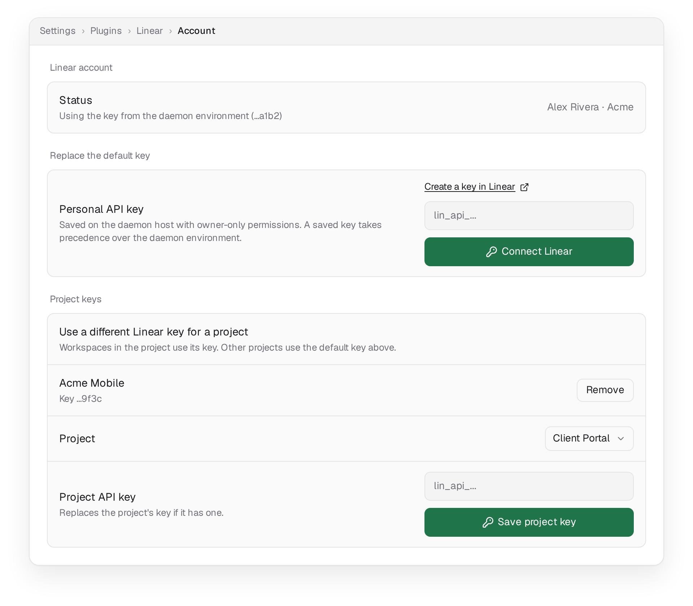

# Connect Linear

The plugin needs a Linear personal API key. Save a default key, set one in the daemon's environment, or give a Paseo project its own.

<picture>
  <source media="(prefers-color-scheme: dark)" srcset="images/keys-dark.png">
  
</picture>

## Default key

1. Open **Settings → Plugins → Linear → Account**
2. Paste your key
3. Select **Connect Linear**

The Linear screen shows the same form until a key is set. The plugin checks the key with Linear before it saves it.

- The daemon saves the key in `$PASEO_HOME/plugin-data/linear/credentials.json`, which is `~/.paseo/plugin-data/linear/credentials.json` by default
- The file has mode `0600` and its folder has mode `0700`
- A saved key takes effect at once
- **Disconnect** deletes the saved key

## Key from the environment

If no key is saved, the plugin uses `LINEAR_API_KEY` from the environment that starts the daemon:

```sh
export LINEAR_API_KEY="lin_api_..."
```

A saved key takes precedence over the environment. To change the environment key, restart the daemon with the new value.

## Project keys

A Paseo project can use a different Linear key, for example for a different Linear workspace.

1. In the **Project keys** section of the Account settings, choose the project
2. Paste the key
3. Select **Save project key**

How project keys apply:

- The Linear panel in a workspace of that project uses the project key
- When project keys exist, the Linear screen shows a key button in the filter row. Use it to switch between **Default key** and the project keys.
- The plugin looks for a key in this order: the project key, the saved default key, then `LINEAR_API_KEY`
- The composer attachment always uses the default key
