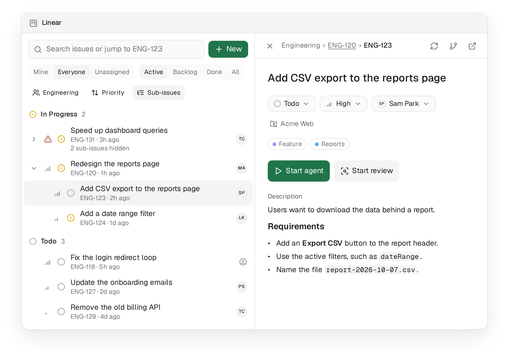

# Issues

Browse, read, and edit Linear issues, attach them to messages, and choose the projects that use Linear.

- [Browse issues](#browse-issues)
- [Sort](#sort)
- [Sub-issues](#sub-issues)
- [Read and edit an issue](#read-and-edit-an-issue)
- [Attach an issue to a message](#attach-an-issue-to-a-message)
- [Linear pill](#linear-pill)
- [Turn Linear on or off per project](#turn-linear-on-or-off-per-project)

## Browse issues

<picture>
  <source media="(prefers-color-scheme: dark)" srcset="images/browse-dark.png">
  
</picture>

Open **Linear** from the sidebar, or run **Linear: Open issues** in the command center. In a workspace, run **Linear: Show issues in this workspace**, or type `/linear` in the composer. `/linear ENG-123` opens that issue, and `/linear <text>` searches.

- The search box matches issue titles and descriptions. An identifier such as `ENG-123` shows that issue only.
- Filter by assignee (**Mine**, **Everyone**, **Unassigned**), by status (**Active**, **Backlog**, **Done**, **All**), and by team
- The list groups issues by status and loads more as you scroll
- If you map Linear teams to a project in **Settings → Plugins → Linear → Projects**, the panel starts with the first mapped team

## Sort

Select the sort button in the filter row. The options are **Last updated**, **Newest**, **Priority**, **Due date**, and **Title**.

## Sub-issues

Select **Sub-issues** in the filter row to nest sub-issues under their parent.

- A sub-issue shows under its parent when the parent is in the list, even if their statuses differ
- Select the chevron to collapse or expand a parent
- A collapsed parent shows how many sub-issues it hides

The issue header shows breadcrumbs: the team, the parent chain, then the issue, for example **Engineering › ENG-120 › ENG-123**. Select a parent to open it. A long chain folds its middle into **…**; select it to show all parents.

## Read and edit an issue

- Select the status, priority, or assignee chip to change it
- Descriptions and comments show as Markdown: headings, lists, task lists, code, quotes, tables, and links
- Select the pencil next to **Description** to edit it as Markdown:
  - The plugin saves about 1 second after you stop typing, and when you leave the box
  - The line under the box shows **Saving…**, then **Saved to Linear**
  - If a save fails, it shows **Could not save** and a **Retry** button
  - **Done** (or Escape) closes the editor only after Linear accepts the text
- Select a task list checkbox in the description to check or uncheck it. The plugin changes only that box in the Markdown and saves it to Linear. If the save fails, the issue reloads from Linear.
- Add a comment in the **Activity** section
- The header buttons refresh the issue, copy its branch name, and open it in Linear
- Select **New issue**, or run **Linear: Create issue**, to create an issue. Set the team, status, priority, assignee, title, and a Markdown description.

## Attach an issue to a message

In the composer, open the attachment menu and choose **Attach Linear issue**. Type an identifier such as `ENG-123`, or words from a title. An empty search lists the 20 most recently updated issues.

The agent gets the issue text with your message. The plugin takes this snapshot when you select the issue.

## Linear pill

Each agent's composer has a **Linear** pill.

- On an agent started from an issue, the pill shows the issue key. It opens the issue status, each sub-issue with its todo progress, and a button that opens the issue. When [todo sync](agents.md#update-linear-from-agent-todos) is on for the project, **Sync now** shows too.
- On other agents, the pill searches Linear and sends the issue text to the agent as a message

## Turn Linear on or off per project

In **Settings → Plugins → Linear → Projects**, **Use Linear in** has an **All projects** switch and one switch per Paseo project. A project switch wins over **All projects**. A project without its own switch follows **All projects**. Save to apply.

In a project where Linear is off:

- The workspace **Linear** panel shows that Linear is off
- Agents get no Linear pill
- The agent setup page does not offer the project
- Todo sync skips the project's agents

The **Linear** screen in the sidebar is not tied to a project, so it stays available. To turn off the whole plugin, use **Settings → Plugins**.
